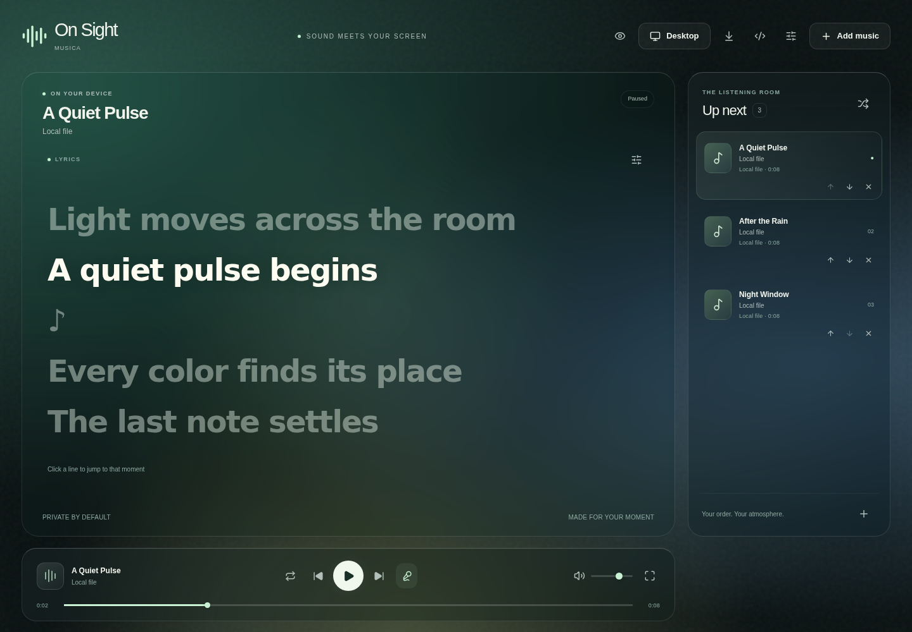

# On Sight Musica

A music player with glass panels, animated lyrics, a side queue and a desktop
wallpaper view. Import your own songs, choose a photo or video backdrop and make
the lyrics part of your desktop.



The screenshot shows the running player with original demo tones and lyric text.
The [wallpaper preview](docs/assets/wallpaper-preview.png) shows the separate
scene used by desktop mode; it is a browser capture, not an operating-system
placement check.

The interface uses TypeScript, React and CSS. The desktop app uses Electron for
Windows and macOS. The same player also runs in a browser, where backgrounds stay
inside the app window. There is no application account, subscription, API key or
per-listener server.

This is an early open-source project. The desktop build and verification commands
are included below. A package build alone does not establish that wallpaper
placement, installation or signing worked on a particular computer.

## Sources and features

| Source      | Playback                | Timed lyrics                    | Desktop wallpaper                      | Transcription                       |
| ----------- | ----------------------- | ------------------------------- | -------------------------------------- | ----------------------------------- |
| Local audio | Full player controls    | Imported or estimated on device | Lyrics with an imported image or video | Opt-in, on device                   |
| Local video | Full player controls    | Imported or estimated on device | The selected video with lyrics         | Opt-in, if its audio can be decoded |
| YouTube     | Official visible player | Imported, outside the player    | No background playback                 | No stream capture                   |
| SoundCloud  | Official visible widget | Imported                        | No provider media in wallpaper         | No stream capture                   |
| Spotify     | Opens in Spotify        | No synchronized clock           | No                                     | No                                  |

Local playback supports seeking, volume, queue reordering, shuffle, repeat and
automatic advancement. Lyrics support LRC and WebVTT import, line seeking, timing
adjustments and LRC export. Appearance controls change the theme, glass opacity,
blur, font, size, weight and motion. Reduced-motion preferences take priority.

YouTube and SoundCloud retain their required controls and attribution. Spotify
items are external links. A desktop wrapper does not add rights to extract,
transcribe or conceal a streaming service's media. See the
[provider guide](docs/providers.md) for supported links and official references.

## Build the desktop app

Install [Node.js 24](https://nodejs.org/en/download) with **npm 11** and
[Git](https://git-scm.com/downloads). The project supports npm 11 for its local
dependency-install settings. On Windows, also install Python 3 and Visual
Studio Build Tools with **Desktop development with C++**. The Windows wallpaper
integration compiles a small native module with `node-gyp`.

Run these commands in PowerShell or Terminal:

```sh
git clone https://github.com/onsightmark/Custom-Music-Player-OS.git
cd Custom-Music-Player-OS
npm ci
npm run desktop
```

The app opens its player window. Import local music, then use the desktop
wallpaper control to show the current scene behind your normal windows. The
player remains the only audio owner. The wallpaper receives its track and lyric
position from that player.

Windows needs a running Explorer desktop. The native integration refuses to
claim success when it cannot attach to that desktop. macOS uses Electron's native
desktop window type. The wallpaper uses the primary display. A display change
stops it with a notice so you can start it again on the current display.
Unsupported platforms still have the browser player.

To create local distribution packages:

```sh
npm run desktop:package
```

Packages are written to `release/`. Building on the target OS is required. Release
signing and macOS notarization require the maintainer's signing credentials.
CI packaging does not publish a release or certify an unsigned build for
installation. Check the PR's actual platform results before distributing it.

The project `.npmrc` skips the unused `onnxruntime-node` binary download. The app
uses the browser WebAssembly runtime for transcription. Other dependency install
scripts, including Electron's download, still run.

## Run the browser version

After `npm ci`, run:

```sh
npm run dev
```

Open the localhost address printed by Vite. For a production build with offline
support, use:

```sh
npm run build
npm run preview
```

Open [http://127.0.0.1:4173](http://127.0.0.1:4173). Let the first online load finish
and reload before testing offline. The development server does not provide the
offline app.

You can install a production browser build through Chrome or Edge. macOS Safari
also supports **File > Add to Dock** on supported versions. Those browser installs
keep backgrounds inside the app window. Use the Electron build for the desktop
wallpaper view. Official browser installation guides are available for
[Chrome](https://support.google.com/chrome/answer/9658361) and
[Safari](https://support.apple.com/104996).

## Add music and lyrics

1. Choose **Add music** and import an audio or video file. You can also paste a
   supported service link.
2. Press **Play**. A browser or provider can require a click before sound starts.
3. Open **Lyric settings** and import an `.lrc` or `.vtt` file. A positive
   **Lyric delay** shows words later. Press Enter or leave the field to save it.
4. Open **Customize appearance** to adjust the scene. **Choose image or video**
   imports your own background. A custom font name uses a font already installed
   on your device.
5. In the desktop app, choose a local track and press **Desktop**. In a browser,
   **Preview wallpaper** opens a separate view of the scene.

Space toggles playback. The left and right arrow keys seek five seconds when
focus is outside an interactive control. The previous button restarts a track
after its first three seconds, otherwise it selects the previous track.

Imports run one at a time. Each finished file and its queue entry save together.
Cancellation or a failed file leaves earlier completed imports in the queue.
Supported extensions include MP3, WAV, M4A, AAC, OGG, FLAC, MP4, WebM and MOV. The
underlying codec must also be supported by the runtime.

The queue limit is 200 tracks. Audio and video are limited to 200 MB per file.
Background images are limited to 20 MB and 40 megapixels. Imported tracks and the
background share a 1 GB storage limit. Available device storage can impose a
lower limit. Keep your original recordings, images and lyric files.

## Generate estimated lyrics

On a local track, open **Lyric settings**, confirm you have permission to
transcribe the file and select **Transcribe on device**. The first run downloads
a pinned Whisper model and runtime, roughly 60 MB. Processing runs in a worker
on your device. The app does not upload the recording. Cancel stops the worker.

The model recognizes English speech. Singing, instruments, overlapping voices
and silence can produce incorrect or invented words. Export the LRC to correct
it and import it again. Inputs are limited to 10 minutes and 50 MB. Offline
transcription depends on cached model files and is not guaranteed.

The app does not capture YouTube, Spotify or SoundCloud audio. See
[transcription and lyric formats](docs/transcription.md) for model and timing
details.

## Privacy and storage

The app stores imported media, lyrics and settings on your device. It has no
analytics service, cloud sync or fallback media upload. Provider players contact
their own services. Opt-in transcription contacts Hugging Face and its download
hosts for model files. Those services receive normal network information such as
your IP address, but the app does not send them your local recording.

Browser storage belongs to its origin and profile. Changing browser, port,
profile or host creates a separate library. The Electron app has its own
persistent profile. Import files in the app you plan to use.

Local storage is not a backup. Clearing site data, removing the application
profile or storage pressure can remove saved content. Keep the original files.
See [SECURITY.md](SECURITY.md) for reporting vulnerabilities.

## Develop and verify

```sh
npm run check
npx playwright install --with-deps chromium firefox webkit
npm run test:e2e
npm run desktop:build
npm run test:e2e:desktop
```

The browser suite drives actual media playback, queue changes, lyric timing,
persistence, interruptions and offline reloads. Desktop journeys launch Electron
and inspect its real windows and media state. Neither suite replaces media clocks
or provider responses.

Live services and model inference have separate network-dependent journeys:

```sh
npm run test:e2e:providers
npm run test:e2e:transcription
```

A blocked media request, provider outage or missing model is an acceptance gap,
not a passing mocked replacement. Fixture sources and rights are documented in
[tests/fixtures/README.md](tests/fixtures/README.md).

The CI workflow defines browser checks on Windows, macOS and Linux, plus native
build, desktop journeys and packaging on Windows and macOS. The workflow's
presence does not mean those jobs have passed. See each PR's run results.
Manual checks still cover wallpaper placement with desktop icons, display
changes, lock and wake, installation, signing and notarization.

Read [CONTRIBUTING.md](CONTRIBUTING.md) and the
[architecture guide](docs/architecture.md) before changing an owner. The
[engineering guide](docs/engineering.md) describes project-specific TOML roles,
the licensed Pstack catalog, Unslop and independent Thermos reviews.

## Host the browser build

Serve the complete `dist/` directory on an HTTPS static host after
`npm run build`. No application server or media proxy is needed. Preserve the
`strict-origin-when-cross-origin` referrer policy required by YouTube. Serve
`.wasm` as `application/wasm` and `.mjs` as JavaScript.

Use revalidation for `index.html`, `sw.js` and the manifest. Hashed assets can use
long immutable caching. Keep one stable origin and path so installations retain
their library. The player asks before reloading for an update.

Hosting serves static files. Each device handles playback and transcription.
This design avoids a per-listener backend but does not establish a measured
concurrency or performance claim.

## License

On Sight Musica code is [MIT licensed](LICENSE). Third-party libraries and
bundled engineering resources retain their own licenses. Users supply recordings
and lyrics they have permission to use.
